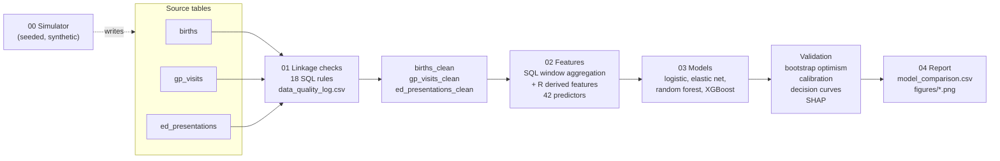
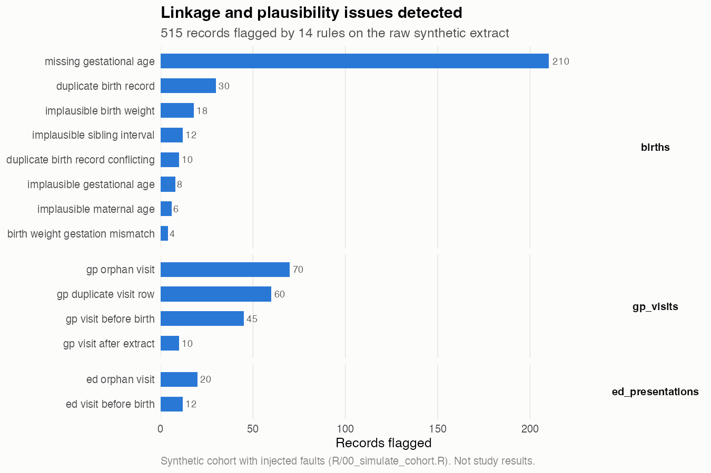
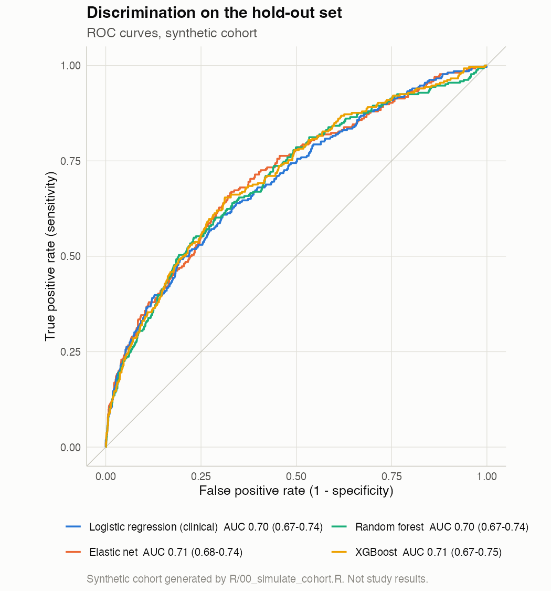
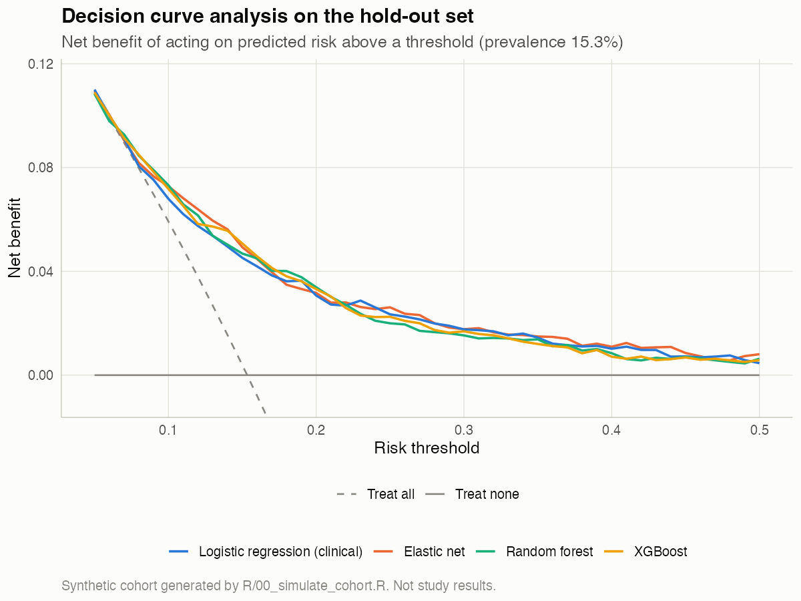
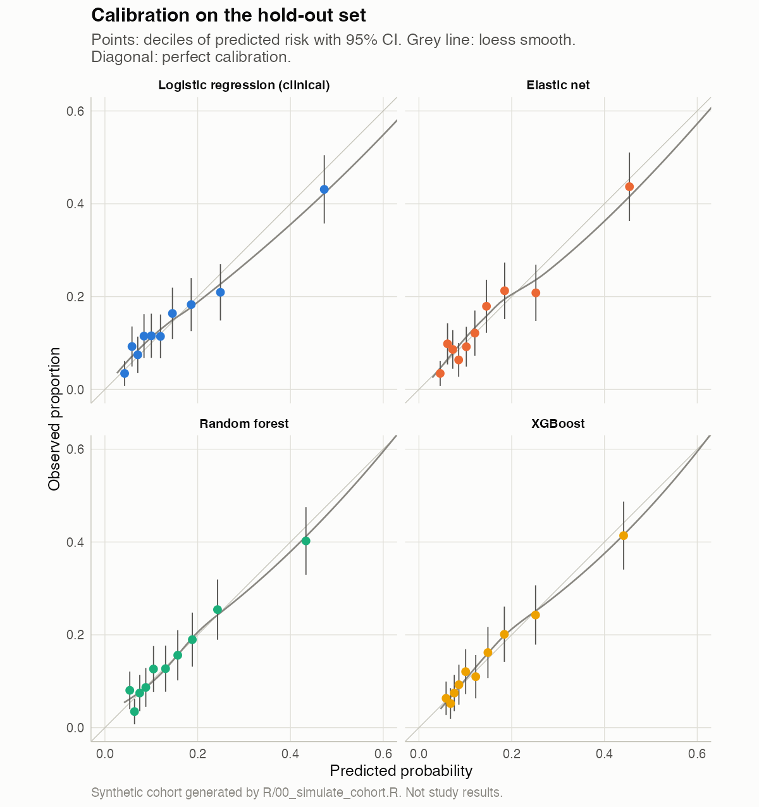
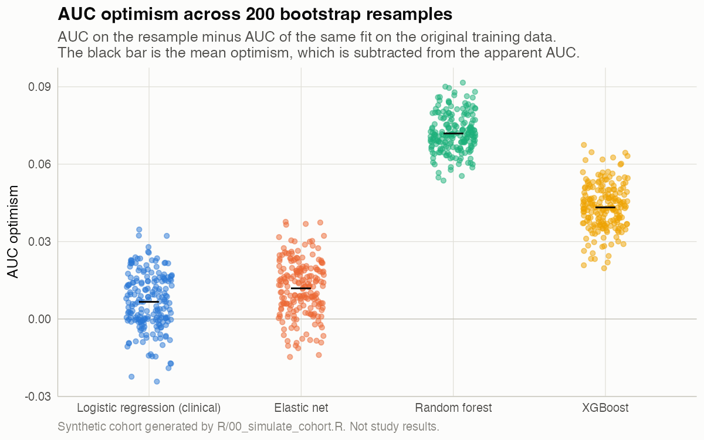
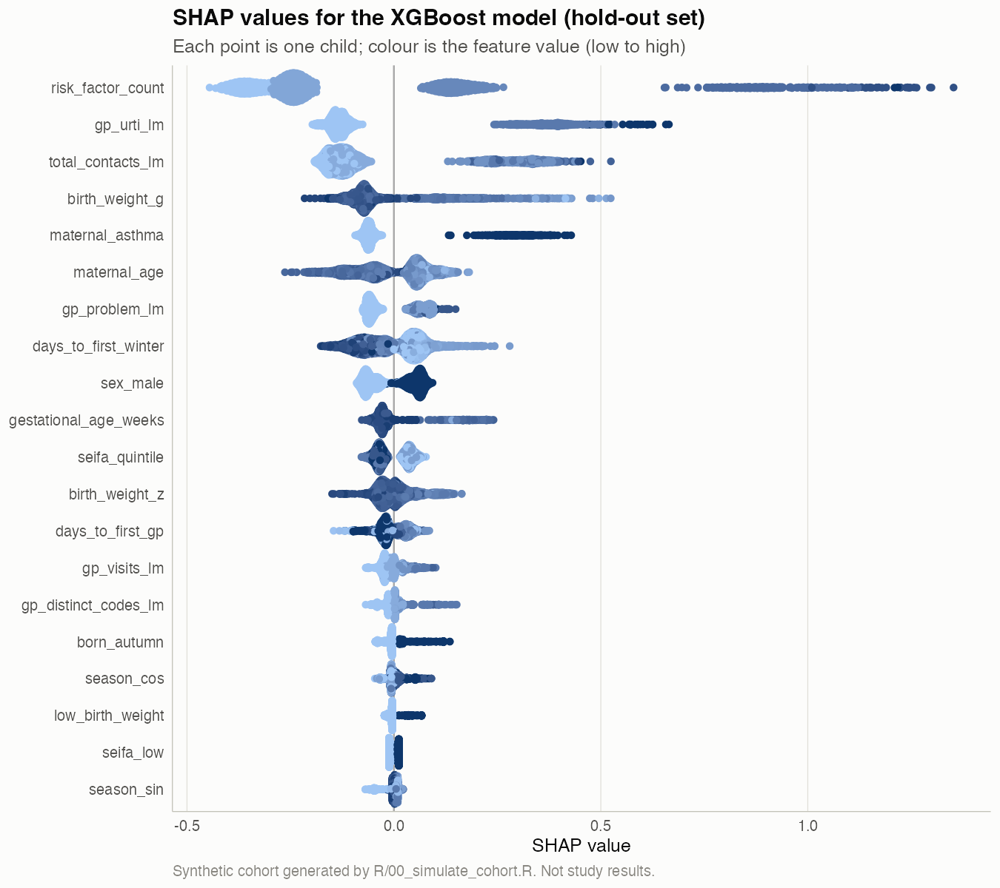
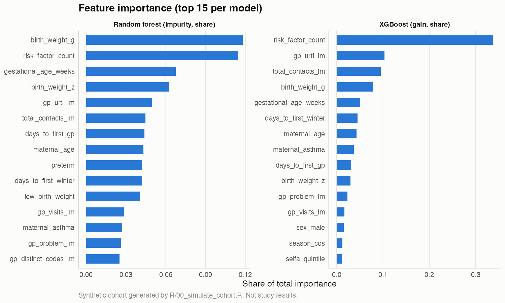

# Predicting wheeze and bronchiolitis in infants

**Machine learning on linked health records from the Breathing for Life cohort**

Research Data Scientist, Hunter Medical Research Institute, 2026
`R` `SQL` `XGBoost` `SHAP` `Power BI`

---

## No real data here

The study behind this repository used confidential linked health records
(birth registrations, general practice and emergency department data) for
children of mothers enrolled in the Breathing for Life cohort at the Hunter
Medical Research Institute. Those records cannot leave the secure research
environment and **none of them are in this repository**, in any form.

This is a **methods repository**. It contains the pipeline, the SQL, the
validation design and the tests, and it runs end to end on a **synthetic
cohort** produced by a seeded simulator (`R/00_simulate_cohort.R`) whose
assumptions are written down below. Every number and figure in this README that
comes from running the code is a property of the simulator, not a finding
about children. The only real result quoted here is in the section
[Context from the real study](#context-from-the-real-study), and it is labelled
as such.

## The study question

Are infants born to mothers with asthma more likely to develop wheeze or
bronchiolitis in the first year of life, and how well can that risk be
predicted from information available early in life? Children were traced
through three record systems: birth registration (perinatal and maternal
factors), general practice encounters and emergency department presentations.
Wheeze was coded as ICD-10-AM `R06.2` and bronchiolitis as `J21.x`.

## Pipeline



| Step | Script | What it does |
|---|---|---|
| 00 | `R/00_simulate_cohort.R` | Generates the synthetic birth, GP and ED tables (CSV and SQLite) and injects linkage faults with an answer key |
| 01 | `R/01_linkage_checks.R` + `sql/01_linkage_checks.sql` | Runs 18 detection rules, logs every issue with the action taken, builds the clean tables |
| 02 | `R/02_features.R` + `sql/02_features.sql` | SQL aggregation to one row per child, then derived clinical features and a feature dictionary |
| 03 | `R/03_models.R` | Four model families, bootstrap optimism correction, hold-out evaluation, decision curves, SHAP |
| 04 | `R/04_report.R` | Data-quality figure and a markdown summary of the run |
| all | `run_all.R` | Runs 00 to 04 in order, each in a fresh R process, and records timings |

## What the linkage checks catch

Linking three administrative datasets produces faults that no model can
recover from if they are not caught first. In the real study the equivalent
log traced more than 200 distinct issues back to the supplying datasets, and
that log became the basis for the conversations with data custodians. The
rules here are the same kinds of rules, written as standalone SQL
(`sql/01_linkage_checks.sql`) so that each one can be read, reviewed and
re-run on its own:

| Fault class | Rule | Action |
|---|---|---|
| Duplicate child records | `child_id` appears more than once; conflicting copies detected separately | Keep the most complete copy; conflicts listed for adjudication |
| Encounter before birth | `visit_date < dob` | Drop (mis-link or wrong DOB) |
| Orphan encounters | `child_id` with no birth record | Drop; counts reported to custodian |
| Implausible birth weight | outside 300-6500 g; 0.3-6.5 recognised as kilograms | Rescale kilograms; otherwise set to missing |
| Missing / implausible gestational age | NULL, or outside 20-44 weeks | Keep with a missingness indicator; impute |
| Implausible maternal age | outside 12-55 | Set to missing |
| Birth weight vs gestation mismatch | term and under 1000 g, or 28 weeks and over 2500 g | Flag for review |
| Mother-id mis-links | two children of one mother born 1-200 days apart | Keep children; ignore the link when counting siblings |
| Duplicate encounter rows | same record id supplied twice | Keep one copy |
| Encounters after the extract date | date later than the extract | Drop |
| Invalid codes | triage outside 1-5, sex not M/F, blank reason code | Drop or set to missing |

The simulator injects ten of these fault classes and writes an answer key
(`data/synthetic/injected_faults.csv`). The test suite checks that **every
injected record is caught** by the corresponding rule, so a change to the SQL
that silently loses a check fails the build. The clean tables are rebuilt from
the raw tables each run; the raw tables are never modified.



## The feature set

Feature engineering is SQL-first: `sql/02_features.sql` joins the three clean
tables and aggregates encounters into one row per child inside SQLite, and
`R/02_features.R` adds the derived clinical variables. The full dictionary
(name, group, description, type, role) is written to
`output/feature_dictionary.csv`. The 42 predictors fall into these groups:

| Group | Examples |
|---|---|
| Demographic | sex |
| Perinatal | gestational age, preterm (<37 wk), very preterm (<32 wk), birth weight, low birth weight, birth-weight z-score within gestational week and sex, small for gestational age, caesarean delivery, missingness indicators |
| Maternal | maternal asthma, smoking in pregnancy, maternal age and age bands |
| Family | parity, older siblings, siblings registered in the extract |
| Socio-economic | SEIFA quintile, disadvantage flag |
| Seasonal | season of birth, sine/cosine month encoding, days from birth to the start of the next winter |
| Early utilisation (to day 60) | GP visits (total, first 30 days, routine vs problem, URTI-coded, distinct reasons), days to first GP visit, ED presentations, high-acuity ED presentations, any contact |
| Interactions and composites | asthma x smoking, preterm x winter birth, count of six established risk factors |

**Landmark design and leakage.** The prediction is made at a landmark age of
60 days. Utilisation features may only use encounters up to that age and
never use an outcome-coded encounter; children who already had a
wheeze/bronchiolitis code by day 60 are excluded (their count is in
`output/cohort_flow.csv`). The outcome is a `J21.x` or `R06.2` code in GP or
ED records on days 61 to 365. A test recomputes a utilisation feature directly
from the raw tables and checks that no single predictor comes close to
separating the outcome on its own.

## Modelling and validation design

Four model families are benchmarked, deliberately spanning the range from the
model a clinician would write down to the model a machine learning engineer
would reach for:

1. **Logistic regression** on 13 pre-specified clinical predictors (the baseline
   that any more complex model has to beat).
2. **Elastic-net logistic regression** (`glmnet`, alpha 0.5, lambda by 5-fold CV)
   on all 42 predictors.
3. **Random forest** (`ranger`, 300 trees, minimum leaf size 40, depth 8).
4. **Gradient-boosted trees** (`xgboost`, depth 3, learning rate 0.05, rounds by
   5-fold CV with early stopping).

The validation design answers three separate questions, because a model can
pass one and fail the others:

* **Does it discriminate, and by how much less than it appears to?**
  Apparent AUC on the training data is optimistic. Harrell's bootstrap
  refits every model on each of *B* resamples, measures the gap between
  performance on the resample and on the original training data, and
  subtracts the average gap from the apparent AUC. The hold-out AUC (30%
  stratified split, percentile-bootstrap 95% CI) is reported alongside as an
  independent check. The optimism distribution is plotted so that an
  over-fitting model is visible, not just corrected.
* **Are the probabilities right?** Brier score and its scaled version
  (improvement over predicting the prevalence), calibration intercept and
  slope on the hold-out set, and a calibration plot by decile of predicted risk
  with a loess smooth. A slope well below 1 means the model is over-confident;
  tree ensembles usually need recalibration before their probabilities are
  shown to anyone.
* **Would acting on it help?** Decision curve analysis plots net benefit
  across risk thresholds from 0.05 to 0.50 against the two default strategies,
  treat everyone and treat no one. A model is only useful at thresholds where
  its curve is above both. Net benefit is implemented in a few lines in
  `R/utils.R` and the tests check it against the `dcurves` package.

SHAP values (`shapviz` on the XGBoost model) and the gain and impurity
importances show *what* the models rely on, which on the synthetic cohort
should be the risk factors the simulator was told to use. On real data this is
where domain review happens: a feature that is important but implausible is
usually a leak.

## Results from the synthetic run

> **These are properties of the simulator.** The synthetic cohort has
> moderate, literature-plausible effect sizes and no unmeasured confounding, so
> these numbers say nothing about real children and are not comparable to the
> real study. Their purpose is to show the pipeline working and to make the
> validation outputs concrete.

Cohort flow on the synthetic run: 6,000 cleaned birth records, 5,783 children
without a wheeze/bronchiolitis code by the 60-day landmark, of whom 886
(15.3%) had the outcome by day 365. Stratified split: 4,048 training, 1,735
hold-out. Bootstrap: 200 resamples (`Rscript run_all.R --n-boot 200`,
about 2 minutes on a laptop). The full table is `output/model_comparison.csv`.

| Model | Predictors | AUC apparent | AUC optimism-corrected | AUC hold-out (95% CI) | Brier | Scaled Brier | Cal. intercept | Cal. slope | Net benefit @ 0.15 |
|---|---|---|---|---|---|---|---|---|---|
| Logistic regression (clinical) | 13 | 0.733 | 0.726 | 0.701 (0.665-0.735) | 0.118 | 0.094 | 0.00 | 0.85 | 0.0452 |
| Elastic net | 42 | 0.745 | 0.733 | 0.711 (0.679-0.745) | 0.116 | 0.103 | 0.01 | 0.93 | 0.0493 |
| Random forest | 42 | 0.835 | 0.763 | 0.705 (0.670-0.740) | 0.118 | 0.092 | -0.00 | 0.95 | 0.0469 |
| XGBoost | 42 | 0.782 | 0.739 | 0.710 (0.674-0.745) | 0.118 | 0.094 | -0.00 | 0.96 | 0.0508 |

Treat-all net benefit at the 0.15 threshold is 0.0039; treat-none is 0.

What the synthetic run illustrates about the *method*, rather than about
children:

* The hold-out AUCs of the four models are within each other's confidence
  intervals: with moderate, mostly additive effects and no unmeasured
  structure, a 13-variable logistic model is nearly as good as the ensembles.
  The real data were not this tidy.
* The random forest's apparent AUC (0.835) is the one a naive report would
  quote; the bootstrap optimism (0.07) brings it back to the others. The
  optimism plot makes the over-fitting visible per model.
* A calibration slope below 1 for the clinical logistic model (0.85) means
  its extreme predictions are a little too extreme on new data; the penalised
  and boosted models sit closer to 1.
* Every model beats treat-all from a threshold of about 0.08 upwards and
  stays above treat-none across the range, with XGBoost and the elastic net
  marginally ahead at the 0.15 threshold.
* SHAP values recover the simulator's own risk factors (the composite risk
  count, early URTI visits, early contacts, birth weight, maternal asthma)
  as the top contributors, which is the check that the feature pipeline is
  wired correctly.

<p align="center">
  
  
</p>
<p align="center">
  
  
</p>





## Context from the real study

This repository is a separate, synthetic re-implementation; it is not the
thesis code. The thesis itself lives in a private UNSW repository and runs as
five R Markdown stages: data preparation and exploratory analysis, multiple
imputation with `mice`, feature selection and model fitting (LASSO, elastic
net, random forest, XGBoost and recursive partitioning), bootstrap validation
with recalibration, and decision curve analysis with SHAP. The numbers in this
README come from the simulator and will not match the thesis.

In the real study the model families were benchmarked with this
validation design on the linked Breathing for Life records. **The selected
model reached an AUC of 0.82**, and a manuscript is in preparation. Because
those records are confidential, the real data-quality log, feature values and
model outputs are not reproduced here. Model outputs and risk-factor summaries
were delivered to the clinical team as a **Power BI** dashboard, which is why
Power BI appears in the project tags although it plays no part in this
repository.

## Simulator assumptions

The simulator (`R/00_simulate_cohort.R`) is seeded and documented so that its
choices can be argued with:

* 6,000 births over two calendar years, with 3% of mothers having a second
  child (or twin) in the window.
* Outcome prevalence 19% in the full cohort (before the landmark exclusion).
  True risk factors, as log-odds: maternal asthma 0.80, smoking in pregnancy
  0.60, preterm birth 0.70 plus 0.12 per week below 37, low birth weight 0.45,
  winter birth 0.70, autumn birth 0.40, older siblings 0.50, male sex 0.25,
  socio-economic disadvantage 0.30, caesarean 0.15, with asthma x smoking and
  preterm x winter interactions.
* Respiratory events cluster in the Southern-hemisphere winter and in the
  2-6 month age band; 30% occur in the emergency department.
* GP use is higher among cases and among families with more children; early
  upper respiratory infections (a non-outcome code) are more common among
  cases, which gives the utilisation features some signal.
* Ten fault classes are injected on top of the clean data (about 500 records)
  and recorded in an answer key.

## How to run

```bash
# R >= 4.3 and the packages listed below
Rscript run_all.R                 # about 40 seconds with the default 50 bootstrap resamples
Rscript run_all.R --n-boot 200    # about 2 minutes; the run used for the figures in this README
Rscript tests/testthat.R          # test suite (expects a completed run)
```

Individual steps can be run on their own (`Rscript R/02_features.R`); each
finds the project root from the working directory. All settings live in
`config.yml` (seed, cohort size, landmark and horizon, bootstrap size,
thresholds).

The synthetic data (`data/synthetic/`) is **not committed**; it is rebuilt by
step 00 in about a second from the seed in `config.yml`, and the test suite
checks that the rebuild is byte-identical. Keeping it out of the repository
also removes any chance of a data file being mistaken for real records. The
small summary tables in `output/` and the figures in `figures/` are committed
so the README can show them.

### Packages

`data.table`, `DBI`, `RSQLite`, `yaml`, `glmnet`, `ranger`, `xgboost`,
`pROC`, `ggplot2`, `shapviz`, `testthat`; `dcurves` is optional (used only in
the tests to cross-check the net-benefit implementation).

```r
install.packages(c("data.table", "DBI", "RSQLite", "yaml", "glmnet", "ranger",
                   "xgboost", "pROC", "ggplot2", "shapviz", "testthat", "dcurves"))
```

## Repository layout

```
.
├── config.yml                  all settings
├── run_all.R                   end-to-end runner
├── R/
│   ├── utils.R                 config, SQL loader, AUC, Brier, calibration, net benefit
│   ├── 00_simulate_cohort.R    seeded synthetic cohort with injected faults
│   ├── 01_linkage_checks.R     runs the SQL rules, writes the data-quality log
│   ├── 02_features.R           SQL aggregation + derived features + dictionary
│   ├── 03_models.R             four models, bootstrap, calibration, DCA, SHAP
│   └── 04_report.R             summary markdown and data-quality figure
├── sql/
│   ├── 01_linkage_checks.sql   18 detection rules + 3 cleaning statements
│   └── 02_features.sql         one-row-per-child feature aggregation
├── tests/testthat/             simulator, linkage, features, models
├── output/                     logs, dictionary, model comparison (committed)
├── figures/                    PNG figures (committed)
└── data/synthetic/             regenerated, not committed
```

## What I would do next

* **Re-tune inside the bootstrap.** Lambda and the number of boosting rounds
  are tuned once and held fixed in the resamples; the strictly honest version
  re-tunes in every resample.
* **Recalibrate the tree ensembles** (Platt or isotonic on a validation fold)
  before comparing decision curves, since their slopes are the ones that drift.
* **Competing information over time.** A landmark at one age is a simplification;
  a sequence of landmarks (30, 60, 90 days) or a time-to-event model would show
  how predictions sharpen as early-life records accumulate.
* **Fairness checks.** Calibration and net benefit by SEIFA quintile and by
  maternal smoking status, since a model that is well calibrated on average can
  still be mis-calibrated in the groups that matter most.
* **A reusable data-quality package.** The rule book pattern (SQL rule,
  plain-English rule, action, record-level detail) generalises well beyond this
  project and would be worth packaging with its own tests.

## Author

**Gichia Muiruri**, MSc Health Data Science (UNSW), Research Data Scientist at
the Hunter Medical Research Institute.
[LinkedIn](https://www.linkedin.com/in/gichia-muiruri) ·
[GitHub](https://github.com/itsgichia)

Released under the [MIT License](LICENSE).
